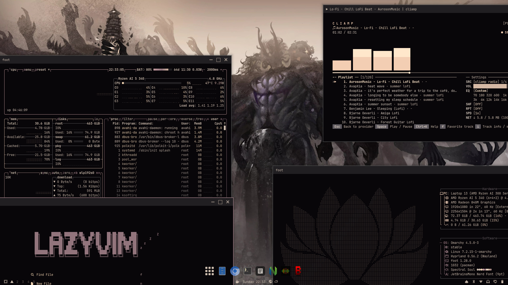
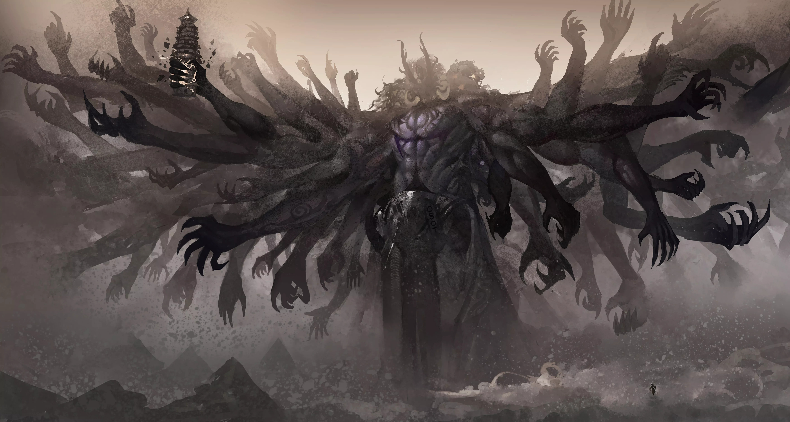

> *Fallen songs and despondent heroes, difficulty in resisting the trials of fate. 
> Bent swords sink in the sand, rising and falling from ancient times, the rumbling of an unceasing heavenly river. 
> Alas... 
> Spectral night carries a soul into endless dreams, where can one rest in peace? 
> During spring and autumn body and mind shifts, only Heaven's Will remains vast and boundless.*

Credit: OSOT
